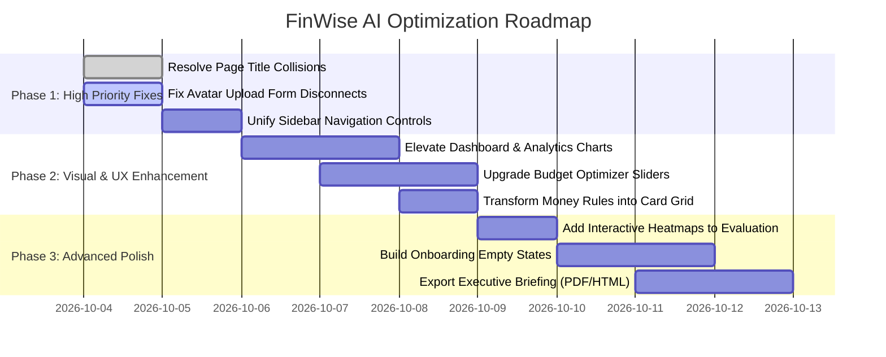

# FinWise AI - Complete Page Design & Element Analysis

**Document Version:** 1.0  
**Generated:** 2026-10-04  
**Scope:** In-depth UI/UX, element inventory, architectural, and optimization analysis across all 15 application pages & views in `finwise-ai-raihan-`.

---

## Table of Contents
1. [Design System & Global Shell Overview](#1-design-system--global-shell-overview)
2. [Page-by-Page Comprehensive Analysis](#2-page-by-page-comprehensive-analysis)
   - [Page 1: Public Landing Page](#page-1-public-landing-page)
   - [Page 2: Sign In (Login)](#page-2-sign-in-login)
   - [Page 3: Create Account (Registration)](#page-3-create-account-registration)
   - [Page 4: Dashboard](#page-4-dashboard)
   - [Page 5: Your Money Snapshot (Integrated Guidance)](#page-5-your-money-snapshot-integrated-guidance)
   - [Page 6: Income & Expenses (Transactions Ledger)](#page-6-income--expenses-transactions-ledger)
   - [Page 7: Clean My Data (Data Preprocessing)](#page-7-clean-my-data-data-preprocessing)
   - [Page 8: Spending Insights (Clustering Analysis)](#page-8-spending-insights-clustering-analysis)
   - [Page 9: Should I Buy This? (Purchase Advisor)](#page-9-should-i-buy-this-purchase-advisor)
   - [Page 10: Smart Budget Helper (CSP Optimizer)](#page-10-smart-budget-helper-csp-optimizer)
   - [Page 11: Money Rules (Rule-Based Advisor)](#page-11-money-rules-rule-based-advisor)
   - [Page 12: Goal Pathfinder (A* Goal Planner)](#page-12-goal-pathfinder-a-goal-planner)
   - [Page 13: Settings (Preferences, Categories & Data)](#page-13-settings-preferences-categories--data)
   - [Page 14: My Profile](#page-14-my-profile)
   - [Page 15: Admin Console](#page-15-admin-console)
   - [Page 16: Model Evaluation ("How Accurate Are the Tools?")](#page-16-model-evaluation-how-accurate-are-the-tools)
3. [Cross-Page Inconsistencies & UX Friction Points](#3-cross-page-inconsistencies--ux-friction-points)
4. [Master UI/UX Optimization Blueprint](#4-master-uiux-optimization-blueprint)
5. [Implementation Priority Roadmap](#5-implementation-priority-roadmap)

---

## 1. Design System & Global Shell Overview

### Color Palette (CSS Custom Properties in `app.py`)
- **Primary Accent (`--primary`):** `#0F766E` (Deep Emerald / Pine Teal)
- **Primary Dark (`--primary-dark`):** `#115E59` (Deep Forest Teal)
- **Primary Tint (`--primary-light`):** `#CCFBF1` (Soft Mint Tint)
- **Background (`--background`):** `#F0FDFA` (Ultra-light airy mint-white)
- **Surface / Card (`--card`):** `#FFFFFF` (Pure white)
- **Borders (`--border`):** `#E2E8F0` (Slate-200 neutral)
- **Ink / Typography (`--ink`):** `#134E4A` (High-contrast deep teal ink)
- **Muted Text (`--muted`):** `#64748B` (Cool slate grey)
- **Semantic Accents:**
  - Success: `#10B981` (Vibrant Emerald)
  - Warning: `#F59E0B` (Warm Amber)
  - Danger: `#F87171` (Coral Red)
  - Highlight Accent: `#2DD4BF` (Bright Turquoise / Mint)

### Typography
- **Headings (H1–H3):** `'Manrope', sans-serif`, font weights 600, 700, 800.
- **Body & UI Elements:** `'DM Sans', sans-serif`, font weights 400, 500, 600, 700.

### Global Shell & Layout Structure
- **Sidebar:** Width 1rem padded, white surface with `1px solid #E2E8F0` border.
  - Brand header lockup: Square monogram `F` with gradient background + "FinWise AI" text.
  - User identity pill: Rounded avatar image or circular initial badge + Name + Email.
  - Workspace navigation: Vertical `st.radio` (11 pages).
  - Admin section: Conditionally displayed `st.radio` (2 pages).
  - Footer action: Full-width "Sign out" button.
- **Main Container:** Max width wide layout, responsive padding (`padding: 54px 5vw` in hero, standard Streamlit main block elsewhere).

---

## 2. Page-by-Page Comprehensive Analysis

---

### Page 1: Public Landing Page
- **Source File:** [`pages/authentication.py`](file:///c:/Projects/finwise-ai-raihan-/pages/authentication.py#L8-L59) (`render_landing`)
- **Route / Trigger:** Public unauthenticated state (`auth_view == "welcome"`)
- **Primary Goal:** Introduce FinWise AI, communicate its algorithmic transparency value proposition, and convert visitors to registration or sign-in.

#### Visual Architecture & Layout
```
+-------------------------------------------------------------+
| [Brand Lockup: F FinWise AI]                   [Sign in CTA]|
+-------------------------------------------------------------+
| HERO SECTION (Gradient Teal Card with Subtle Angled Grid)    |
|   Left (1.1fr):                               Right (0.9fr):|
|   - Eyebrow Badge                             - Step 01 Flow|
|   - H1: FinWise AI                            - Step 02 Flow|
|   - H2: Subheadline                           - Step 03 Flow|
|   - Hero Paragraph                                          |
+-------------------------------------------------------------+
|                 [Create your account (Primary)]             |
+-------------------------------------------------------------+
| Feature Card 01        Feature Card 02      Feature Card 03 |
| (01 / Understand)      (02 / Explore)       (03 / Plan)     |
+-------------------------------------------------------------+
| Disclaimer Caption                                          |
+-------------------------------------------------------------+
```

#### Detailed Element Inventory
1. **Top Bar:** 2-column layout (`[3, 1]`) with SVG/CSS brand lockup on the left and a "Sign in" ghost/outline button on the right.
2. **Hero Container (`.landing-hero`):**
   - CSS background: Multi-stop linear gradient (`rgba(17,94,89,.97)` to `rgba(45,212,191,.78)`) with 135-degree repeating grid overlay.
   - Left column copy: Eyebrow text (`PERSONAL FINANCE, MADE EXPLAINABLE`), H1, H2, and lead paragraph.
   - Right column visual (`.hero-visual`): Frosted glass card (`backdrop-filter: blur(10px)`) illustrating a 3-step pipeline (`01 Transactions` → `02 Models & algorithms` → `03 Traceable guidance`).
3. **Primary Call to Action:** Centered 3-column wrapper with a full-width primary button "Create your account".
4. **Feature Grid:** 3 equal columns with cards (`.feature-card`) featuring numbered eyebrow headers and benefit descriptions.
5. **Footer Notice:** Small caption explaining local isolation and synthetic training limits.

#### Design Strengths
- Strong visual branding with cohesive teal/mint gradient hero.
- Clean typography hierarchy using Manrope for bold headings and DM Sans for body.
- Clear privacy message upfront.

#### UX Flaws & Friction Points
- The "Create your account" CTA is floating in a separate 3-column row below the hero rather than nestled inside the hero itself.
- On smaller screens (< 768px), the 3 feature cards collapse abruptly without spacing adjustments.
- Missing social proof, feature screenshots, or interactive preview tabs.

#### Optimization Recommendations
- **Hero CTA Integration:** Place "Get Started Free" and "Live Demo" buttons directly inside the hero copy column.
- **Interactive Feature Preview:** Add an animated or tabbed product mockup showing the Cash Flow chart and Purchase Advisor verdict card.
- **Benefit Badges:** Add icon chips (e.g. 🔒 100% Local SQLite, ⚡ No Cloud Upload, 🧠 Open Explainable ML).

---

### Page 2: Sign In (Login)
- **Source File:** [`pages/authentication.py`](file:///c:/Projects/finwise-ai-raihan-/pages/authentication.py#L60-L86) (`render_login`)
- **Route / Trigger:** Public state (`auth_view == "login"`)
- **Primary Goal:** Fast, secure user authentication with brute-force lockout protection.

#### Visual Architecture & Layout
- Header bar: Return button `"← FinWise AI"` with eyebrow `"ACCOUNT ACCESS"` and H1 `"Welcome back"`.
- Asymmetric 2-column layout (`[1.2, 0.8]`):
  - Left column: Clean `st.form("finwise_login_form")`.
  - Right column: Educational side card (`.auth-note`) explaining workspace privacy + CTA to create account.

#### Detailed Element Inventory
1. **Back Navigation:** `"← FinWise AI"` button that redirects back to landing.
2. **Login Form:**
   - Email text input with `autocomplete="email"`.
   - Password input with `type="password"`, `autocomplete="current-password"`.
   - Primary submit button: `"Sign in"`.
3. **Security Handler:** Catches `ValueError` from `authenticate_user` (e.g., account lockouts after 5 failed attempts) and displays styled error with lock icon.
4. **Side Card (`.auth-note`):** Mint-accented border-left card reinforcing local data isolation.
5. **Alternative Action:** Secondary button `"New to FinWise? Create account"`.

#### UX Flaws & Friction Points
- No "Show/Hide Password" toggle (Streamlit password input has limited native reveal toggling).
- No "Forgot Password" or account reset explanation for local accounts (users should be reminded their data is local to SQLite).
- The back button takes up an entire row column above the title, pushing the form downwards.

#### Optimization Recommendations
- **Streamlined Card Layout:** Center the login form in a glassmorphic card on wide monitors for a more focused auth flow.
- **Local Credential Guidance:** Add a tooltip or caption explaining: *"Since FinWise stores accounts locally on your computer, your password never leaves this machine."*
- **Quick Demo Fill:** Add a 1-click "Explore Demo Account" button for reviewers/evaluators.

---

### Page 3: Create Account (Registration)
- **Source File:** [`pages/authentication.py`](file:///c:/Projects/finwise-ai-raihan-/pages/authentication.py#L87-L122) (`render_register`)
- **Route / Trigger:** Public state (`auth_view == "register"`)
- **Primary Goal:** User onboarding with profile metadata, secure password creation, and optional avatar upload.

#### Visual Architecture & Layout
- Header with return button and eyebrow title.
- Asymmetric 2-column layout (`[1.2, 0.8]`):
  - Left column: Registration form + Avatar file uploader.
  - Right column: Information card ("An empty account is intentional") + Sign-in redirect button.

#### Detailed Element Inventory
1. **Registration Form:**
   - Display Name (`max_chars=80`, `autocomplete="name"`).
   - Email address (`autocomplete="email"`).
   - Password (`type="password"`, `autocomplete="new-password"`).
   - Confirm Password (`type="password"`).
   - Primary submit button: `"Create account"`.
2. **Avatar Uploader:** `st.file_uploader` supporting PNG, JPG, JPEG, WEBP.
3. **Side Card:** Explains that new accounts start with an empty ledger, encouraging CSV upload or demo data import.
4. **Security Footnote:** Clarifies PBKDF2 100k iteration hashing and local image storage.

#### UX Flaws & Friction Points
- **Form Hierarchy Disconnect:** The `st.file_uploader` for avatar is placed *below* the `st.form` submit button! When users select an avatar after filling fields, the page reruns before they hit submit, or users hit submit before uploading.
- Password strength indicator is missing (no minimum length or complexity check feedback).
- The confirm password error only triggers upon full form submission.

#### Optimization Recommendations
- **Move Avatar Upload:** Either include the file upload seamlessly in the form structure or move it to an optional Post-Registration Onboarding step.
- **Live Password Validation:** Display clear requirements (e.g., min 8 characters) with visual checkmarks.

---

### Page 4: Dashboard
- **Source File:** [`pages/dashboard.py`](file:///c:/Projects/finwise-ai-raihan-/pages/dashboard.py)
- **Route / Nav Label:** `"Dashboard"` in navigation (Displays title `"Your Money Snapshot"` inside file).
- **Primary Goal:** Executive overview of total balance, cash flow, category breakdowns, anomalies, active goals, and immediate action items.

#### Visual Architecture & Layout
```
+-------------------------------------------------------------+
| H1: Your Money Snapshot (Dashboard)                         |
| View Period: ( ) This month   (o) Last 30 days   ( ) Custom |
+-------------------------------------------------------------+
| [ Balance Metric ] [ Income Metric ] [ Expense ] [ Savings%]|
+-------------------------------------------------------------+
| CONSUMER PROFILE BADGE (Heavy / Balanced / Light Consumer)  |
+-------------------------------------------------------------+
| Left (1.15fr): Cash Flow Bar Chart | Right (0.85fr): Pie &   |
| (Income vs Expense by Month)       | Top 5 Categories Table |
+-------------------------------------------------------------+
| A Closer Look:                                              |
| - Left: Unusual Repeat Costs       | Right: Active Goals    |
|   (Anomalies Alert / Success)      | (Progress bars)        |
+-------------------------------------------------------------+
| Recent Transactions (5-row table)                           |
+-------------------------------------------------------------+
| Insight from Activity Banner (st.info)                      |
| [Recommended Next Action Banner]       [Should I Buy This?]|
+-------------------------------------------------------------+
```

#### Detailed Element Inventory
1. **Period Filter:** Horizontal radio (`This month`, `Last 30 days`, `Custom`) with dynamic date picker fallback.
2. **Top KPI Metrics (4-column grid):**
   - Current balance (includes opening capital + cumulative net delta).
   - Income (with period comparison delta).
   - Expenses (with inverted positive/negative delta coloring).
   - Savings Rate (percentage + percentage points delta).
3. **Spending Pattern Banner:** Dynamic colored pill card (Red for Heavy, Amber for Balanced, Green for Light) with explanation copy.
4. **Cash Flow Visualization:** Plotly grouped bar chart comparing monthly income vs expenses.
5. **Category Spending Donut:** Plotly donut chart (`hole=0.68`) with custom palette + 5-row formatted table.
6. **Cost Anomaly Detection:** Compares repeated transaction descriptions with >=3 priors and flags 1.5x median spikes.
7. **Goal Progress Cards:** Progress bars for up to 4 active goals with target amounts and due dates.
8. **Recent Activity Table:** Latest 5 transactions with date, description, category, and currency formatting.
9. **Next Action CTA:** Direct link button navigating to the "Should I Buy This?" advisor.

#### UX Flaws & Friction Points
- **Title Collision:** Uses `st.title("Your Money Snapshot")` exactly identical to Page 5 (`integrated_guidance.py`), causing navigation disorientation.
- When the ledger is empty, charts simply disappear with text warnings; needs a polished "Empty State Zero-Data" hero illustration with sample data load button.
- Custom period picker only appears when "Custom" is selected, causing sudden layout shifting.

#### Optimization Recommendations
- **Rename Title:** Change to `st.title("Financial Command Center")` or `st.title("Financial Overview")`.
- **Stat Cards Enhancement:** Add subtle sparkline trendlines inside the top 4 metric cards.
- **Interactive Drill-down:** Allow clicking on a category slice in the donut chart to filter the recent transactions table.

---

### Page 5: Your Money Snapshot (Integrated Guidance)
- **Source File:** [`pages/integrated_guidance.py`](file:///c:/Projects/finwise-ai-raihan-/pages/integrated_guidance.py)
- **Route / Nav Label:** `"Your Money Snapshot"`
- **Primary Goal:** Comprehensive synthesized report bringing together all model outputs (K-Means, CSP Budget, Classifier, Rules, A* Goals) into one unified briefing.

#### Visual Architecture & Layout
- Vertical progressive disclosure structure divided into 7 distinct sections:
  1. Financial Summary (4 primary metrics + 3 secondary metrics).
  2. Spending Pattern (K-Means cluster & feature breakdown).
  3. Budget Suggestions (CSP optimization result table & explanation).
  4. Should I Buy This? (Latest purchase risk check verdict & comparison).
  5. Saving Recommendations (Triggered rule engine priorities).
  6. Goal Roadmap (A* path summary and milestone schedule).
  7. Top 3 Actions (Prioritized evidence-backed recommendations).
  8. Explainer accordion ("How to read this report").

#### Detailed Element Inventory
1. **Cache Invalidation Watcher:** Compares current transaction fingerprint against saved session runs; issues warnings if any module run is out-of-sync.
2. **7-Metric Summary Grid:** 4-col summary + 3-col detail (Income, Expenses, Remaining balance, Savings ratio, Burn rate, Discretionary ratio, Processed features).
3. **Top 3 Action Matrix:** Dynamically collects outputs from rules, purchase risks, CSP allocations, and A* goals, sorts them by priority (`High > Medium > Low`), and presents them as numbered action items.

#### UX Flaws & Friction Points
- **Excessive Vertical Scroll:** The page has over 8 full-width headers without any visual anchors, tabs, or jump-to navigation.
- If modules haven't been run yet, multiple gray `st.info` placeholder boxes stack up, looking unpolished.
- Lack of export/print functionality: This is the ideal page to export as a formatted PDF or printable executive summary.

#### Optimization Recommendations
- **Executive Summary Card at Top:** A single high-impact "Health Score" or "Financial Readiness Index" badge.
- **Section Tabs or Sticky Jump-Links:** Group sections into `[Overview & Metrics, Spending & Budgeting, Decisions & Goals, Action Plan]`.
- **"Print / Export Executive Brief" Button:** 1-click HTML/PDF formatted report generation.

---

### Page 6: Income & Expenses (Transactions Ledger)
- **Source File:** [`pages/transactions.py`](file:///c:/Projects/finwise-ai-raihan-/pages/transactions.py)
- **Route / Nav Label:** `"Income & Expenses"`
- **Primary Goal:** Full transaction lifecycle management: filtering, pagination, sorting, manual CRUD entry, custom bank CSV column mapping, and export.

#### Visual Architecture & Layout
- Top Summary: 3 key metrics (Total Income, Total Expenses, Current Balance).
- 4 Tabbed Workspaces:
  - Tab 1: `Transactions` (Filter form + Pagination + Interactive Table + CSV Download).
  - Tab 2: `Add transaction` (Type selector + 3-col input form).
  - Tab 3: `Edit or delete` (Select transaction dropdown + Edit form + Delete checkbox & button).
  - Tab 4: `Import CSV` (File uploader + Smart Column Mapper + Top 5 Preview + Append button).

#### Detailed Element Inventory
1. **Filter Controls:**
   - Text search with case-insensitive matching across description, category, and type.
   - Type dropdown (`All`, `Income`, `Expense`).
   - Category dropdown (populated from unique transaction categories + user custom categories).
   - Date range picker.
2. **Pagination Engine:**
   - Rows per page selector (`25`, `50`, `100`).
   - `← Previous` and `Next →` buttons with boundary disabling.
   - Status badge: `"Page X of Y · N matches"`.
3. **Smart CSV Import Mapper:**
   - Auto-detects standard FinWise format.
   - Custom format fallback: Fuzzy heuristics match date, amount, description, type, and category columns.
   - Interactive preview table before database insertion.

#### UX Flaws & Friction Points
- Filtering requires an explicit "Apply filters" form submission; live filtering or debounced instant search would feel significantly faster.
- In Tab 3 ("Edit or delete"), selecting a transaction requires browsing a single long dropdown list of IDs and descriptions, which becomes unwieldy with hundreds of transactions.
- No bulk delete or batch categorization tools.

#### Optimization Recommendations
- **Quick-Filter Chips:** Add 1-click pills for `"This Month"`, `"Large Expenses (>$100)"`, `"Uncategorized"`.
- **Inline Table Actions:** Allow quick editing or category reassignment directly in the dataframe view.
- **CSV Import Wizard:** Add visual badges showing matched columns and confidence score.

---

### Page 7: Clean My Data (Data Preprocessing)
- **Source File:** [`pages/data_processing.py`](file:///c:/Projects/finwise-ai-raihan-/pages/data_processing.py)
- **Route / Nav Label:** `"Clean My Data"`
- **Primary Goal:** Demystify ML preprocessing pipelines for users by visualizing imputation, one-hot encoding, MinMax scaling, and engineered feature sets.

#### Visual Architecture & Layout
- Pipeline Stage Breadcrumbs (Horizontal chain: `YOUR TRANSACTIONS → Fill missing details → Label categories → Align number scales → Add monthly context → READY TO EXPLORE`).
- 4 Pipeline Metric Cards:
  1. Missing values detected
  2. Category labels prepared
  3. Number fields aligned
  4. Details ready for analysis
- Side-by-side dataframes: "Raw transactions" vs "After missing-value handling".
- Encoded & Normalized feature preview tables.
- Monthly money snapshot metrics & summary table.
- Expander containing final model features matrix.

#### Detailed Element Inventory
1. **Pipeline Flow Banner:** Inline HTML flex container showing color-coded pipeline stages.
2. **Side-by-side Comparisons:** Dual column view (`st.columns(2)`) comparing raw uncleaned data with imputed data.
3. **Engineered Metrics:** Calculates savings ratio, 30-day burn rate, and discretionary spending share.

#### UX Flaws & Friction Points
- The horizontal breadcrumb row uses hardcoded inline styles and HTML entities (`→`) that look dated and wrap awkwardly on mobile devices.
- Tables show raw one-hot encoded boolean columns (e.g. `category_Food`, `category_Housing`) which can look intimidating to non-technical users without an explanatory badge.
- No interactive controls to test different imputation strategies (e.g., median vs forward fill).

#### Optimization Recommendations
- **Visual Stepper Component:** Replace text arrows with a sleek CSS stepper component featuring completion checkmarks.
- **Data Quality Scorecard:** Add a "Ledger Health Grade" (e.g. `98% Complete`, `Zero Missing Dates`, `Clean Categories`).
- **Interactive Explainer Tooltips:** Add hover tooltips explaining why MinMax scaling is necessary for K-Means and KNN algorithms.

---

### Page 8: Spending Insights (Clustering Analysis)
- **Source File:** [`pages/spending_analysis.py`](file:///c:/Projects/finwise-ai-raihan-/pages/spending_analysis.py)
- **Route / Nav Label:** `"Spending Insights"`
- **Primary Goal:** Unsupervised K-Means clustering analysis of monthly behavior, classifying the user into dynamic spending profiles (`Heavy`, `Balanced`, `Light Consumer`) with drift tracking.

#### Visual Architecture & Layout
- Top profile badge: Large heading display of cluster profile + observations count + Pattern Shift (drift metric).
- Primary Visualization: 2D Plotly Scatter Plot (`Savings Ratio` vs `Discretionary Ratio`) with custom colored cluster points and a gold star for the user's latest month.
- Cluster Characteristics Benchmark Table (transactions/mo, typical spend, savings ratio, burn rate).
- Month-by-month detailed historical classification table.
- Explanatory expander defining consumer archetypes.

#### Detailed Element Inventory
1. **Drift Metric:** Indicates whether recent monthly behavior is trending toward higher or lower spend clusters.
2. **Plotly Scatter Plot:** Interactive scatter plot with custom tooltips, formatted percentage axes, and star marker for "You".
3. **Centroid Table:** Dynamic breakdown of cluster averages mapped to readable financial metrics.

#### UX Flaws & Friction Points
- The scatter plot is placed inside an expander (`with st.expander("View spending pattern chart", expanded=True)`), adding an unnecessary border/dropdown wrapper around the main chart.
- If less than 3 months of data exist, the page displays a generic info message and stops; it should guide users on how to import historical data.
- The 2D plot only shows 2 of the 6 features used in K-Means (savings ratio & discretionary ratio); the other 4 features (burn rate, variance, frequency, ticket size) are only shown in tables.

#### Optimization Recommendations
- **Remove Expander around Main Chart:** Make the scatter plot a full-width hero element on the page.
- **Radar / Spider Chart Addition:** Add a multi-axis Radar chart comparing the user's latest month against the 3 cluster centroids across all 6 dimensions.
- **Actionable Takeaways:** Provide a personalized tip for the assigned profile (e.g., *"As a Balanced Consumer, trimming optional subscriptions could move you into the Light Consumer tier"*).

---

### Page 9: Should I Buy This? (Purchase Advisor)
- **Source File:** [`pages/purchase_advisor.py`](file:///c:/Projects/finwise-ai-raihan-/pages/purchase_advisor.py)
- **Route / Nav Label:** `"Should I Buy This?"`
- **Primary Goal:** Pre-purchase decision support tool evaluating immediate affordability, goal deadline delay, and dual-model classification verdicts (`Strong Yes`, `Cautious Yes`, `Better Wait`, `No`).

#### Visual Architecture & Layout
```
+-------------------------------------------------------------+
| H1: Should I Buy This?                                      |
| Warning Banner: Synthetic model disclaimer                  |
+-------------------------------------------------------------+
| [ Monthly Income ] [ Monthly Spend ] [ Savings% ] [ Profile]|
+-------------------------------------------------------------+
| PURCHASE INPUT FORM:                                        |
| Item Name (Col 1.4)              Category (Col 1.0)         |
| Price (Col 1.0)                  Available Balance (Col 1.0)|
| Days Left in Month (Col 1.0)     Urgency 1-5 Slider (Col 1.0|
| Goal Affected Dropdown (Full width)                         |
| [ Check this purchase (Primary Button) ]                    |
+-------------------------------------------------------------+
| PREDICTION VERDICT CARD (Green/Amber/Orange/Red Banner):    |
|   "CAUTIOUS YES" - Sony WH-1000XM5 ($349.99)                |
+-------------------------------------------------------------+
| [ Main Estimate ] [ Estimate Confidence ] [ Spending Style ]|
+-------------------------------------------------------------+
| Main Model (Logistic Reg)    | Second Opinion (KNN)         |
| Class Probabilities Table    | Class Probabilities Table    |
+-------------------------------------------------------------+
| Why this result (Bullet reasons)                            |
| Goal Impact (Delay in months & extra savings needed)        |
| Alternative Suggestion (e.g., "At $279.99 verdict = Yes")   |
+-------------------------------------------------------------+
```

#### Detailed Element Inventory
1. **Context KPI Strip:** Prefills income, expenses, savings rate, and consumer type from the ledger.
2. **Simulation Form:** Item name, category weight, price, current cash balance, days remaining in month, urgency scale (1–5), and target goal.
3. **Verdict Hero Banner:** High-visibility color-coded card with bold typography for the verdict.
4. **Model Comparison Grid:** Dual side-by-side probability breakdown comparing Logistic Regression (Primary) and K-Nearest Neighbors (Secondary opinion).
5. **Goal Delay Simulation:** Calculates exact delay in months and required compensatory monthly savings.
6. **Smart Price Discovery:** Re-runs the classifier at 15%, 30%, 45%, 60%, 75% discounts to find the exact price point that flips a negative verdict to positive.

#### UX Flaws & Friction Points
- The verdict banner uses hardcoded inline CSS with fixed font sizes that don't scale gracefully on mobile.
- The dual probability tables show raw percentages in small dataframes rather than visual progress/bar gauges.
- The "Why this result" section is a plain bulleted text list without visual hierarchy.

#### Optimization Recommendations
- **Visual Probability Gauges:** Replace tabular probabilities with horizontal stacked confidence bars.
- **Goal Impact Visual Timeline:** Show a mini timeline displaying `Current Deadline` vs `Pushed Deadline with Purchase`.
- **"Add to Wishlist" or "Save Decision":** Allow users to bookmark checked purchases to review later.

---

### Page 10: Smart Budget Helper (CSP Optimizer)
- **Source File:** [`pages/budget_optimizer.py`](file:///c:/Projects/finwise-ai-raihan-/pages/budget_optimizer.py)
- **Route / Nav Label:** `"Smart Budget Helper"`
- **Primary Goal:** Constraint Satisfaction Problem (CSP) budget optimization using backtracking, forward checking, and MRV to generate mathematically balanced monthly allocations.

#### Visual Architecture & Layout
- Category calibration expander (inspect recent spend per category).
- Budget Parameter Form: Net monthly income + 8 category target inputs arranged in 2-column rows.
- Plan Status Header (`A plan fits your limits` vs `No plan fits these inputs`).
- Comparative Tables: Requested amounts vs Required minimums vs Allocated amounts.
- Metric Row: Total allocation, Unallocated balance, Discretionary spending cap.
- Visual Budget Breakdown: Plotly colored bar chart of allocated categories.
- Algorithmic Search Statistics: Nodes explored, feasible solutions found.

#### Detailed Element Inventory
1. **Interactive Calibrator:** Selectbox to review actual past spending in any category to inform targets.
2. **Form Inputs:** Numerical inputs for Housing, Food, Transportation, Health, Education, Debt Payment, Emergency Reserve, Discretionary, and Savings.
3. **CSP Solver Engine:** Implements recursive search with branch-and-bound pruning.
4. **Summary Metrics:** Highlights surplus/unallocated capital and discretionary spending ceilings.

#### UX Flaws & Friction Points
- Entering 9 separate numerical fields in small boxes is tedious and prone to typing errors.
- No live validation showing the user whether their requested inputs already exceed their entered income before they click submit.
- The allocation bar chart uses vertical bars; a horizontal breakdown bar or Donut/Treemap would represent parts of a whole much better.

#### Optimization Recommendations
- **Interactive Budget Sliders with Real-Time Total:** Replace number inputs with linked sliders showing a live balance meter: `Remaining: $X of $Total Income`.
- **50/30/20 Benchmark Preset:** Add 1-click preset buttons: `"50/30/20 Rule"`, `"Aggressive Savings (40%)"`, `"Debt Payoff Focus"`.
- **Visual Treemap / Sankey Diagram:** Replace the standard bar chart with a flow diagram showing Income splitting into Fixed, Flexible, and Future Savings.

---

### Page 11: Money Rules (Rule-Based Advisor)
- **Source File:** [`pages/rule_advisor.py`](file:///c:/Projects/finwise-ai-raihan-/pages/rule_advisor.py)
- **Route / Nav Label:** `"Money Rules"`
- **Primary Goal:** Transparent, deterministic financial rule engine evaluating critical health checks (emergency fund runway, debt-to-income, savings rate, burn rate).

#### Visual Architecture & Layout
- Top Context: Identifies transaction month being evaluated and inferred debt payments.
- Input Form: Emergency reserve current balance, target balance, and monthly debt payment.
- Rule Results Table: Overview dataframe showing Rule ID, Condition, Current Value, Threshold, Status (`Triggered` vs `Passed`), and Priority.
- Rule Details Section: Series of `st.expander` components for each evaluated rule.

#### Detailed Element Inventory
1. **Rule Set:**
   - `R01`: Low savings ratio alert (< 10%).
   - `R02`: Healthy savings ratio milestone (>= 20%).
   - `R03`: Excessive discretionary spending (> 20%).
   - `R04`: Inadequate emergency reserve (< target).
   - `R05`: High 30-day burn rate relative to income (> 80%).
   - `R06`: High debt-to-income payment ratio (> 20%).
2. **Dynamic Formatting:** Correctly formats ratios as percentages and balances as currency.

#### UX Flaws & Friction Points
- Stacking 6 individual expanders below a table creates repetitive visual clutter.
- The rule status table is a raw dataframe; it lacks colored pill badges (Green for Passed, Red for High Priority Triggered, Amber for Medium).
- Users cannot tweak rule thresholds directly on this page (they have to navigate to Settings).

#### Optimization Recommendations
- **Card-Based Rule Grid:** Transform the table into a visual grid of 6 interactive rule cards with clear status icons (✅ / ⚠️ / 🚨).
- **Inline Threshold Quick-Tuning:** Provide a toggle to open threshold sliders without having to switch pages to Settings.
- **Actionable Fix Buttons:** Each triggered rule card should link to the corresponding tool (e.g. `R04 Emergency Fund` links to Goal Pathfinder).

---

### Page 12: Goal Pathfinder (A* Goal Planner)
- **Source File:** [`pages/goal_planner.py`](file:///c:/Projects/finwise-ai-raihan-/pages/goal_planner.py)
- **Route / Nav Label:** `"Goal Pathfinder"`
- **Primary Goal:** Heuristic graph search (A* algorithm) to chart an optimal, low-disruption month-by-month savings trajectory toward a financial target.

#### Visual Architecture & Layout
- Monthly surplus baseline indicator from current ledger.
- Goal Planning Form: Goal name, Target price, Current savings, Maximum monthly saving, Optional lifestyle cut cap, Target deadline.
- Plan Summary Metrics: Months to goal, Goal achievement month, Lifestyle adjustment cost, Monthly options checked.
- Selected Monthly Route Table: Month-by-month breakdown with contributions, cumulative savings, and remaining targets.
- Cumulative Savings Trajectory Chart: Plotly line chart with dashed target threshold line.
- Explanatory State Inspection: Expander showing explored state space.

#### Detailed Element Inventory
1. **A* Search Engine:** Admissible heuristic balancing distance to target with lifestyle disruption penalties.
2. **Persistent Goal Storage:** Automatically saves the created goal to SQLite so other pages (Dashboard, Purchase Advisor) can immediately reference it.
3. **Deadline Feasibility Warning:** Alerts users if the mathematically optimal path cannot meet their requested calendar deadline.

#### UX Flaws & Friction Points
- The lifestyle disruption penalty is expressed as an abstract float (e.g. `14.50`), which lacks intuitive meaning to users.
- The goal plan only handles one goal at a time; users cannot see how multiple competing goals interact.
- The trajectory chart is a simple line plot without milestone markers or shaded confidence bounds.

#### Optimization Recommendations
- **Milestone Timeline Visual:** Display a visual timeline with milestone badges (e.g., `25% Reached in March`, `Halfway Point in June`, `Goal Achieved in November`).
- **Multi-Goal Roadmap:** Allow viewing all saved goals on a single interactive timeline.
- **Friendly Penalty Translation:** Rephrase "Lifestyle adjustment: 12.0" into human terms: *"Requires a moderate monthly lifestyle cut of ~$120/mo"*.

---

### Page 13: Settings (Preferences, Categories & Data)
- **Source File:** [`pages/settings.py`](file:///c:/Projects/finwise-ai-raihan-/pages/settings.py)
- **Route / Nav Label:** `"Settings"`
- **Primary Goal:** Central control panel for default preferences, custom income/expense category creation, financial rule threshold tuning, demo data management, and data export/reset.

#### Visual Architecture & Layout
- Preferences Section: Default dashboard period selectbox.
- Custom Categories Section: Add category form + Custom category list with delete buttons.
- Financial Rule Thresholds Section: 5 interactive sliders for customizing alert parameters.
- Data Management & Privacy: Demo data loader, Privacy disclosure, "Export My Data" ZIP download button.
- Module Readiness Status: Informational matrix table.
- Danger Zone: Clear all financial data with confirmation checkbox.

#### Detailed Element Inventory
1. **Threshold Tuning Sliders:** Allows configuring `savings_low`, `savings_healthy`, `discretionary`, `burn_rate_income`, and `debt_income`.
2. **Category Management:** Full CRUD for user-defined tags that seamlessly integrate into the transaction ledger and budget optimizer.
3. **Data Portability:** ZIP export packaging profile JSON, preferences JSON, goals JSON, and transactions SQLite database.
4. **Safe Data Purge:** Dual-confirmation deletion of financial records preserving login credentials.

#### UX Flaws & Friction Points
- Very long single page with 6 distinct sections separated only by `st.divider()`.
- The Danger Zone button ("Clear all my data") is right below the Module Status table without sufficient visual quarantine.
- Slider adjustments in the Threshold section lack visual indicators of how the change will affect current rule evaluations.

#### Optimization Recommendations
- **Tabbed Settings Categories:** Divide the page into clean tabs: `[General & Categories, Rule Thresholds, Data & Privacy, Account Security]`.
- **Danger Zone Visual Redesign:** Enclose the data reset controls in a prominent red-bordered warning card.
- **Live Rule Preview:** Show a mini-preview of which rules would trigger under the newly adjusted slider thresholds before saving.

---

### Page 14: My Profile
- **Source File:** [`pages/profile.py`](file:///c:/Projects/finwise-ai-raihan-/pages/profile.py)
- **Route / Nav Label:** `"My Profile"`
- **Primary Goal:** User identity management, display name editing, avatar upload, liquid starting capital configuration, password change, and archive export.

#### Visual Architecture & Layout
- User Identity Header: Circular avatar or two-letter initial badge + Name + Email + Role Badge (`Admin` / `Member`) + Member Since date.
- Update Profile Form: Display name input + Avatar file uploader.
- Financial Starting Capital Form: Opening liquid balance input field with explanation.
- Change Password Form: Current password, New password, Confirm password.
- Export Data Section: Download ZIP button.

#### Detailed Element Inventory
1. **Avatar Renderer:** Supports local WEBP profile pictures with automatic circular initial badge fallback.
2. **Liquid Starting Capital:** Configures baseline opening capital (`initial_balance`) which cascades into true available balance calculations across Dashboard, Transactions, and Purchase Advisor.
3. **Password Change Pipeline:** Verifies PBKDF2 hash of current password before updating to new hash.

#### UX Flaws & Friction Points
- Similar to registration, the avatar file uploader is positioned outside the update profile form, causing potential submission confusion.
- The page contains multiple independent forms stacked vertically, leading to an unnecessarily long scrolling page.
- Opening balance input is halfway down the page despite being a critical financial setting.

#### Optimization Recommendations
- **Profile Card & Bento Layout:** Combine user avatar, role, and starting balance into an elegant top Bento-grid card.
- **Modal / Expander for Password Change:** Place the sensitive password change form inside a tidy security accordion.
- **Account Activity Stats:** Show quick stats (e.g. `Total Transactions Logged`, `Active Goals`, `Last Login Date`).

---

### Page 15: Admin Console
- **Source File:** [`pages/admin.py`](file:///c:/Projects/finwise-ai-raihan-/pages/admin.py)
- **Route / Nav Label:** `"Admin Console"` (Visible only to `role == "admin"`)
- **Primary Goal:** Operational telemetry, aggregate account counts, user directory overview, global demo model performance benchmarks, and sample dataset downloads.

#### Visual Architecture & Layout
- Top KPI Metrics (4 columns): Accounts, Admin accounts, Private ledgers, Total transaction rows.
- Accounts Table: User summary table with Name, Email, Role, Joined date, Transactions count, Last active, and Total transaction volume.
- Global Demo Model Evaluation: Accuracy, Precision, Recall, F1 metrics table for Logistic Regression and KNN + Example ledger cluster distribution chart.
- Sample Data Management: Copy example transactions to own ledger + CSV download buttons for demo data and synthetic training sets.
- Admin role setup guide expander with PowerShell command snippet.

#### Detailed Element Inventory
1. **Zero-Knowledge Privacy Barrier:** Explicitly restricted to aggregate counts and metadata; administrators cannot inspect private user transaction descriptions, amounts, or dates.
2. **System Health Metrics:** Real-time SQLite query aggregating users, admin counts, and total ledger rows across the installation.
3. **Sample Asset Distribution:** Instant download buttons for bundled CSV datasets.

#### UX Flaws & Friction Points
- The user directory table shows a "Total Volume" column; while useful, without currency formatting flags or active/inactive indicators it looks raw.
- No user role toggle (an admin cannot promote another user to admin through the UI; it requires environment variable manipulation).
- Global model evaluation is duplicated between this page and Page 16 (`model_evaluation.py`).

#### Optimization Recommendations
- **User Activity Filter:** Add filtering to the user table (e.g., search by email, filter by active/inactive).
- **Database Backup & Vacuum Tool:** Add a 1-click SQLite maintenance button (`VACUUM`, integrity check, database backup).
- **Consolidate Evaluation View:** Keep this page strictly focused on System Operations & Users, linking to Page 16 for in-depth model diagnostics.

---

### Page 16: Model Evaluation ("How Accurate Are the Tools?")
- **Source File:** [`pages/model_evaluation.py`](file:///c:/Projects/finwise-ai-raihan-/pages/model_evaluation.py)
- **Route / Nav Label:** `"How Accurate Are the Tools?"` (Visible to admins)
- **Primary Goal:** Complete academic and algorithmic auditing interface exposing test benchmarks, confusion matrices, silhouette scores, CSP search stats, and A* heuristic tracking.

#### Visual Architecture & Layout
- Classifier Section: Evaluation metrics table (Accuracy, Macro-Precision, Macro-Recall, Macro-F1) + Confusion matrix expander for both models.
- K-Means Clustering Section: Inertia, Silhouette score, cluster distribution table, and 2D scatter plot.
- CSP Budget Section: Hard constraints count, search nodes explored, backtracks, and prunes.
- A* Goal Planning Section: States explored, path length, final cost, and `f(n) = g(n) + h(n)` heuristic breakdown table.
- Rule Engine Section: Rule evaluation counts and status breakdown.

#### Detailed Element Inventory
1. **Holdout Evaluation Table:** Macro metrics computed over holdout test rows.
2. **Confusion Matrices:** Actual vs Predicted 4x4 matrix across `Strong Yes`, `Cautious Yes`, `Better Wait`, `No`.
3. **Mathematical Heuristic Table:** Explicitly displays the `g(n)` (path cost), `h(n)` (admissible heuristic estimate), and `f(n)` total for every monthly step.

#### UX Flaws & Friction Points
- The confusion matrices are displayed as raw standard Streamlit dataframes; without heatmap color-coding, diagonal accuracy is difficult to read at a glance.
- If the user hasn't run the CSP or A* tools in their current session, large sections display "Insufficient data for reliable evaluation" info boxes.
- The scatter plot is again wrapped in an expander.

#### Optimization Recommendations
- **Confusion Matrix Heatmaps:** Render Seaborn/Plotly interactive heatmaps with intensity shading on diagonal true positives.
- **Benchmark Run Generator:** Provide a "Run Synthetic Benchmark Suite" button that runs all algorithms on standardized benchmarks if session state is empty.
- **Educational Formula Explanations:** Include LaTeX/math formula cards (e.g. $f(n) = g(n) + h(n)$, Silhouette Score formula) for academic presentations.

---

## 3. Cross-Page Inconsistencies & UX Friction Points

| Issue | Impact | Affected Pages | Root Cause |
|---|---|---|---|
| **Title Duplication** | High | Dashboard vs Integrated Guidance | Both use `st.title("Your Money Snapshot")`. |
| **Form & Uploader Disconnect** | High | Register, Profile | `st.file_uploader` sits outside or below the form, triggering unwanted page reruns. |
| **Navigation State Fragmentation** | Medium | Sidebar Navigation | Workspace pages and Admin tools use two separate `st.radio` controls. |
| **Unnecessary Chart Expanders** | Medium | Spending Analysis, Model Evaluation | Primary visualizations are tucked inside collapsed/expanded expanders. |
| **Raw Dataframe Dominance** | Medium | Transactions, Rules, CSP, Settings | Too many plain data tables where visual cards, chips, and progress bars belong. |
| **Empty State Blandness** | Medium | Dashboard, Spending, Transactions | Empty ledgers show plain gray `st.info` notices rather than engaging onboarding prompts. |
| **Inflexible Number Inputs** | Low | Budget Optimizer, Settings | High-friction repetitive typing instead of linked sliders and smart presets. |

---

## 4. Master UI/UX Optimization Blueprint

### A. Navigation & Shell Modernization
1. **Single Unified Navigation:** Merge workspace and admin tools into a structured navigation menu with clear section headers or a styled pill navigator.
2. **Distinct Page Branding:** Give every page a unique title, icon, and contextual subtitle.
   - Dashboard $\rightarrow$ *"Financial Overview & Command Center"*
   - Integrated Guidance $\rightarrow$ *"Unified Financial Intelligence Brief"*

### B. Component Standardization
1. **Metric Cards:** Standardize all KPI cards with subtle glassmorphic styling, icon accents, and sparkline indicators.
2. **Data Tables:** Replace raw dataframes with styled cards or enriched tables featuring badges, formatted currencies, and direct action triggers.
3. **Form Architecture:** Ensure all file uploads, sliders, and inputs are enclosed in coherent forms with clear submit buttons and live inline validations.

### C. Visual Analytics & Charts
1. **Plotly Styling System:** Standardize all chart templates with custom mint/teal theme tokens, hidden modebars, responsive heights, and formatted tooltip cards.
2. **Interactive Visualizations:**
   - Donut charts for category breakdown with center total.
   - Flow/Treemap for budget allocations.
   - Heatmap for confusion matrices.
   - Interactive radar charts for spending profiles.

---

## 5. Implementation Priority Roadmap



### Immediate Next Steps for Pairing:
1. **Fix Title & Route Clarity:** Update [`pages/dashboard.py`](file:///c:/Projects/finwise-ai-raihan-/pages/dashboard.py) title to distinguish it clearly from [`pages/integrated_guidance.py`](file:///c:/Projects/finwise-ai-raihan-/pages/integrated_guidance.py).
2. **Modernize Dashboard Visuals:** Enhance the top KPI metric cards and replace standard table lists with rich visual cards.
3. **Streamline Auth & Profile Forms:** Move file uploaders properly into the user update flows to eliminate extra page refreshes.
4. **Upgrade Decision & Planning UIs:** Refactor Budget Optimizer to use interactive sliders and Money Rules into a responsive card layout.
